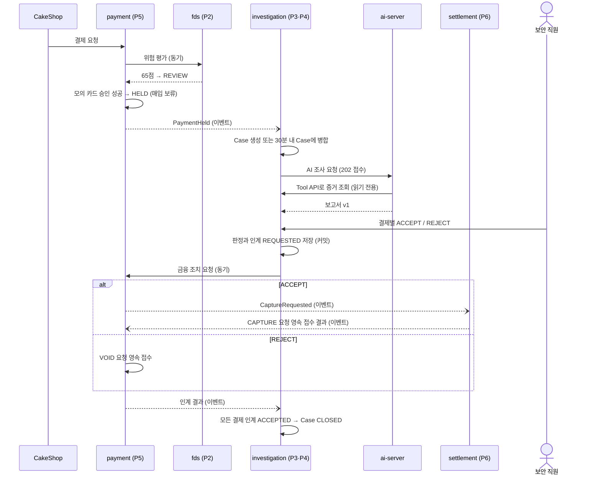
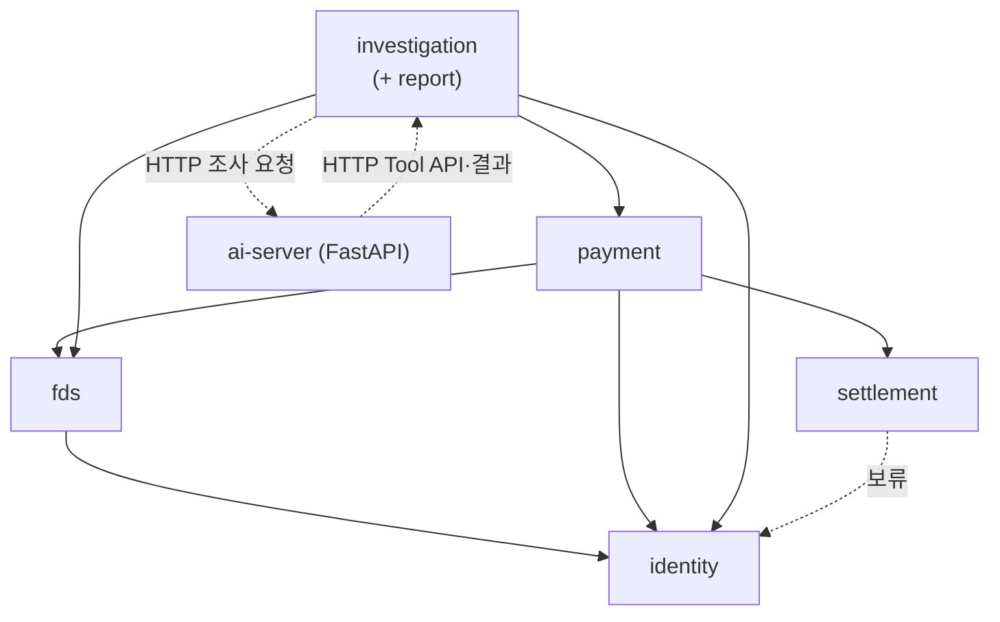

# DonWorry

DonWorry는 케이크 주문 서비스 CakeShop에서 발생한 결제를 받아 **FDS 위험평가 → 카드 승인·매입 보류 → Case 조사 → AI 조사 보고서 → 결제별 직원 판정 → 매입·승인 취소 인계 → 정산**까지 하나의 흐름으로 처리하는 결제 대행(PG)·이상거래 탐지 백오피스입니다. 의심 결제를 바로 거절하지 않고, 카드 승인은 받되 매입을 보류한 채 보안 직원이 근거를 보고 결제마다 판단하도록 돕는 데 초점을 둡니다.

Spring Boot 4 · Spring Modulith 기반 백엔드, React 화면, FastAPI AI 서버로 구성된 모노레포입니다.

> **개인 개발 저장소입니다.** 팀 저장소에서 갈라져 나와, 멘토 피드백(10/23)을 반영한 새 기획을 먼저 구현하고 있습니다.
> 새 기획의 정본은 Notion **최종 기획+설계서**이고, 테이블 변경 내역은 [ERD 7절](docs/erd/README.md#7-목표-erd-변경-내역-개인-issue-3)에 있습니다.
> 이 README는 실행 방법과 틀린 안내만 고친 상태이며, 전체 내용은 기능을 만든 뒤 다시 씁니다.

## 목차

- [Overview](#overview)
- [Features](#features)
- [핵심 흐름](#핵심-흐름)
- [Tech Stack](#tech-stack)
- [Getting Started](#getting-started)
- [Quick Start](#quick-start)
- [Project Structure](#project-structure)
- [Contributing](#contributing)
- [Architecture & Developer Playbook](#architecture--developer-playbook)
- [현재 상태](#현재-상태)

## Overview

- CakeShop(1차 프로젝트)과 연동하는 **2차 팀 프로젝트**이며, 6명이 업무 모듈을 하나씩 맡아 개발합니다.
- 서버를 여러 개로 나누지 않고, **하나의 Spring Boot 앱을 모듈 5개로 나누는 모듈러 모놀리스** 구조를 씁니다. 모듈 경계는 Spring Modulith 테스트로 강제합니다 ([Modulith 문서](docs/modulith/README.md)).
- 새 기획은 기능 축 3개로 나뉩니다.
  1. **결제 FDS + 구매자 메일**: CakeShop 결제를 Rule로 평가하고, 의심 결제는 매입을 보류한 채 AI 보고서를 참고해 직원이 판정합니다. 구매자에게는 결제 상태만 메일로 알립니다 (사유 · 점수는 알리지 않음)
  2. **돈워리 직원 계정 보호**: 보안 직원 계정이 탈취되면 사기 결제가 허용될 수 있어, 2단계 인증 · 직원 Rule 7개 · 2인 승인 · 감사 로그로 막습니다
  3. **자금 관리**: 가맹점 사장님에게 정산 캘린더, 14일 자금 예측, Mock 은행 대출 상품을 보여 줍니다
- FDS 연계 업무(위험평가 → HELD → Case·AI 조사 → 직원 판정 → 금융 조치 인계)의 흐름·상태값·통신 방식 정본은 Notion **fds 정본** 페이지(01 업무분석 · 02 기획 · 03 설계, DB 구현 가이드는 04)입니다. 테이블·컬럼(ERD) 정본은 Notion **팀페이지 / ERD**입니다 ([ERD 요약](docs/erd/README.md)). 이 README는 그 요약입니다.
- P6 담당 ERD의 1차 범위는 이벤트 수신 후 즉시 매입·수수료 계산·정산 예정금 저장입니다. 픽업 정보와 정산 완료 배치는 2차 범위입니다. Notion 출처와 FDS 인계 계약의 남은 차이는 [문서 대조 현황](docs/README.md)에 기록했습니다.
- CakeShop 연동 저장소: [HyunGyu-Cho/CakeShop](https://github.com/HyunGyu-Cho/CakeShop) (개인 fork, DonWorry 연동에 맞게 수정 예정)

## Features

> 아래는 새 기획 범위입니다. 테이블과 Rule 초기 데이터는 있고, 기능은 **구현 예정**입니다.

- **결제(PG) · P5** — CakeShop 결제 세션, FDS 평가 요청, 모의 카드사 승인, REVIEW 승인 건의 매입 보류(HELD), 승인 취소(VOID), 결제 상태 관리(DENIED · DECLINED · HELD · CAPTURED · VOIDED · EXPIRED), CakeShop 결과 통지
- **FDS 위험평가 · P2** — 차단 목록과 일치하면 즉시 DENY, 아니면 결제 Rule 8개(고액 · 평소보다 큰 금액 · 처음 쓰는 카드 · 신규 계정 · 카드 테스팅 · 거절 후 재시도 · 해외/익명 접속)의 점수를 더해 판정합니다: 0~39 ALLOW · 40~69 REVIEW · 70 이상 DENY. 평가 실패는 ERROR이며 자동 ALLOW하지 않음. Rule 카탈로그는 `fds_rules`, 차단 목록은 `blocklist_entries`
- **직원 계정 보호 · P1 · P2 · P3** — 2단계 인증(OTP) · 로그인 실패 잠금, 직원 Rule 7개(로그인/OTP 실패 반복 · 사내망 밖/새 기기 · 세션 동시 사용 · 판정 이상 · 탐지 설정 완화 · 분산 로그인 실패 · 비밀번호 뿌리기). AI 권고와 반대인 판정과 Rule 끄기는 2인 승인, 직원 계정 사건은 보안 관리자가 판정, 모든 조작은 감사 로그
- **구매자 메일 · P5** — 결제 상태 안내와 "본인 결제가 맞나요?" 확인 메일. 구매자 응답은 약한 근거로만 쓰고 AI 재조사로 넘김
- **Case 조사 · 직원 판정 · P3** — HELD 결제 1건부터 Case 생성. 같은 가맹점·고객이면 최초 생성 후 30분 미만, 판정 전까지 병합. 보안 직원이 결제별 ACCEPT(매입 허용) / REJECT(승인 취소) 판정. 금융 조치 인계가 모두 확인되면 Case 종료
- **AI 조사 보고서 · P4** — Case 단위 보고서, 결제가 병합되면 새 버전으로 재조사(이전 버전 보존). 읽기 전용 Tool로 증거 조회, 증거 출처는 보고서 JSON 안에 기록. 총 3회 실패하면 직원이 직접 조사해 판정(`report_id` 없이 사유에 근거 기록). AI는 결제를 바꾸지 않음
- **매입 · 정산 · P6** — CAPTURE 요청 이벤트 수신 후 즉시 매입, 수수료·정산 예정금 계산 및 `SCHEDULED` 저장. 별도 일일 매입 배치는 두지 않음. 픽업·정산 완료·취소 연동은 2차 범위이며, 영속 접수 결과와 실행 결과의 세부 계약은 확인 필요
- **자금 관리 · P6** — 정산 캘린더, 14일 자금 예측(저장하지 않고 정산 예정금으로 계산), Mock 은행 대출 상품 조회 (신청 · 심사 없음)
- **조사 기한** — Case 최초 생성 후 24시간을 내부 목표로 경고(권장값, 확정 아님). 기한 초과만으로 자동 판정하지 않음

## 핵심 흐름

의심 결제가 승인 후 매입 보류되고, 보안 직원 판정이 금융 조치로 인계되는 시연 시나리오입니다. 모듈 간 통신 방향은 [ADR-0012](docs/decisions/0012-payment-settlement-dependency.md)를 따르며, 이벤트 이름·필드는 아직 합의 중입니다.



- Case `CLOSED`는 결제 완료가 아닙니다. 실제 매입·취소 결과는 결제 상태(`CAPTURED` · `VOIDED`)로 따로 확인하며, Case 종료 전후 어느 때든 끝날 수 있습니다.
- DENY는 카드 승인 없이 `DENIED`, 카드 승인 실패는 `DECLINED`이며 둘 다 Case를 만들지 않습니다.

## Tech Stack

| 구분 | 기술 | 버전 |
| --- | --- | --- |
| Backend | Java | 21 |
| | Spring Boot | 4.1.1 |
| | Spring Modulith | 2.1.1 |
| | Spring Data JPA · Spring Security · Lombok | Boot 관리 |
| | Gradle | 9.3.0 (Wrapper) |
| Database | MariaDB | 11.8 (Docker Compose) |
| | Flyway | Boot 관리 |
| Frontend | React · React Router | 19 · 7 |
| | TypeScript · Vite | 7 · 8 |
| | oxlint · Prettier | — |
| AI Server | Python · FastAPI | 3.13 · — |
| | uv · ruff · pytest | — |
| CI | GitHub Actions | 서비스별 3개 + 문서 검사 1개 |

정확한 버전은 `backend/build.gradle`, `frontend/package.json`, `ai-server/pyproject.toml`을 기준으로 합니다.

## Getting Started

### 사전 준비

| 도구 | 용도 |
| --- | --- |
| JDK 21 | backend 빌드·실행 |
| Docker Desktop | 개발용 MariaDB 실행 (직접 설치한 MariaDB도 가능) |
| Node.js 22 | frontend |
| Python 3.13 + [uv](https://docs.astral.sh/uv/) | ai-server |

Gradle은 설치하지 않아도 됩니다. `gradlew`가 정해진 버전을 내려받아 씁니다.

### 1. 저장소 내려받기

```bash
git clone https://github.com/HyunGyu-Cho/DonWorry.git donworry-personal
cd donworry-personal                # 기본 브랜치 main (dev 브랜치 없음)
```

### 2. DB 실행

Docker로 MariaDB 11.8을 **3307** 포트에 띄웁니다. DB와 계정(`donworry` / `donworry`)이 자동으로 만들어집니다.

```bash
docker compose up -d          # 저장소 루트에서
docker compose down -v        # DB 초기화가 필요할 때 (데이터 삭제)
```

Docker 없이 직접 설치한 MariaDB를 쓴다면 관리자 계정으로 한 번 실행합니다.

```sql
CREATE DATABASE donworry CHARACTER SET utf8mb4 COLLATE utf8mb4_unicode_ci;
CREATE USER 'donworry'@'%' IDENTIFIED BY 'donworry';
GRANT ALL PRIVILEGES ON donworry.* TO 'donworry'@'%';
```

> **팀 저장소와 같은 PC에서 쓴다면 DB를 분리합니다.** 두 저장소가 같은 `donworry` DB를 쓰면, 이 저장소의 새 migration이 팀 DB에 들어가 팀 저장소 기동이 깨질 수 있습니다.
> 관리자 계정으로 개인용 DB를 만들고 (`donworry` 계정의 host에 맞춰 GRANT)
>
> ```sql
> CREATE DATABASE donworry_personal CHARACTER SET utf8mb4 COLLATE utf8mb4_unicode_ci;
> GRANT ALL PRIVILEGES ON donworry_personal.* TO 'donworry'@'localhost';
> GRANT ALL PRIVILEGES ON donworry_personal.* TO 'donworry'@'127.0.0.1';
> ```
>
> 3절의 `backend/.env`에 `DONWORRY_DB_NAME=donworry_personal`을 적습니다.

테이블은 백엔드를 실행할 때 Flyway가 `backend/src/main/resources/db/migration/`의 파일을 순서대로 적용해 만듭니다.
테이블 추가 순서, 로컬 DB 초기화, 오류 해결은 **[Flyway 문서](docs/flyway/README.md)** 를 봅니다.

> **Flyway 전환(#23) 이전에 앱을 띄운 적이 있다면** `Found non-empty schema` 에러로 기동이 멈춥니다. 한 번 초기화가 필요합니다.
> 직접 설치한 MariaDB를 쓰고 있다면 `docker compose down -v`로는 해결되지 않습니다. 앱이 어느 DB에 붙었는지부터 확인합니다 → [작업 가이드 2·3절](docs/flyway/05-guide.md#2-내-앱이-어느-db에-붙었는지-확인)

### 3. 설정 파일 (.env)

폴더마다 예시 파일을 복사해 `.env`로 씁니다. `.env`는 Git에 올라가지 않고, 테스트는 읽지 않습니다 (#84).

```powershell
# Windows PowerShell
copy backend\.env.example backend\.env
copy ai-server\.env.example ai-server\.env
copy frontend\.env.example frontend\.env
```

```bash
# macOS / Linux
cp backend/.env.example backend/.env && cp ai-server/.env.example ai-server/.env && cp frontend/.env.example frontend/.env
```

DB가 기본값(`localhost:3307` / `donworry` / `donworry`)과 다르면 `backend/.env`의 `DONWORRY_DB_*`를 바꿉니다.
AI 조사를 함께 볼 때는 서비스 키를 두 곳(`backend/.env`, `ai-server/.env`)에 같은 값으로 넣습니다.
시연 전체 순서는 **[시연 켜는 법](docs/demo-run.md)** 을 봅니다.

### 4. backend 실행

```powershell
cd backend
.\gradlew.bat bootRun         # Windows
```

```bash
cd backend
./gradlew bootRun             # macOS / Linux
```

`Started DonWorryApplication`이 보이면 `http://localhost:8081`에서 실행 중입니다.

### 5. frontend 실행

```bash
cd frontend
npm install
npm run dev
```

`http://localhost:5173`에서 열립니다. `/api`로 시작하는 요청은 백엔드(8081)로 전달됩니다.

프론트는 로컬 시연 로그인과 공통 헤더·사이드바를 제공합니다.
보안 직원의 **Case 목록·상세와 경보 목록·상세**는 목업 데이터로 동작합니다.
거래 내역·사장님 조치 결과·정산 현황은 `EmptyPage`의 **담당자 구현 영역**입니다.
실제 인증·업무 API는 연동 전입니다.
시연 계정·실행 방법은 [프론트 README](frontend/README.md),
담당 페이지 연결 방법은 [공통 레이아웃 적용 가이드](frontend/공통레이아웃_적용가이드.md)를 참고합니다.

### 6. ai-server 실행

```bash
cd ai-server
uv sync
cp .env.example .env          # Windows: copy .env.example .env
uv run uvicorn app.main:app --reload --port 8000
```

`http://localhost:8000/health`가 `{"status":"ok"}`를 돌려주면 정상입니다.

### 7. 빌드와 테스트

PR을 올리기 전에 바꾼 영역의 검사를 돌립니다. CI도 같은 검사를 합니다.

```bash
cd backend   && ./gradlew spotlessApply check   # Windows: .\gradlew.bat spotlessApply check
cd frontend  && npm run lint && npm run format:check && npm run build
cd ai-server && uv run ruff format . && uv run ruff check . && uv run pytest
```

`spotlessApply`와 `ruff format`은 코드 모양(들여쓰기·줄바꿈)을 자동으로 맞춥니다 ([ADR-0013](docs/decisions/0013-code-formatter.md)). `./gradlew check`는 DB 없이 돌아갑니다. 모듈 관계도는 `./gradlew test` 후 `backend/build/spring-modulith-docs/`에 생깁니다.

### 실행 포트

| 구성 | 포트 |
| --- | --- |
| CakeShop | 8080 |
| backend | 8081 |
| frontend (개발 서버) | 5173 |
| ai-server | 8000 |
| MariaDB (Docker) | 3307 |

### 자주 발생하는 문제

- **`docker compose up`이 포트 충돌로 실패** — PC에 직접 설치한 MariaDB나 MySQL이 3307을 쓰고 있습니다. 그 서비스를 중지하거나, 직접 설치한 DB를 쓰고 `backend/.env`의 `DONWORRY_DB_*`로 접속 정보를 맞춥니다.
- **`Access denied for user 'donworry'@'localhost'`** — DB 계정 비밀번호가 기본값과 다릅니다. `backend/.env`의 `DONWORRY_DB_PASSWORD`에 실제 비밀번호를 넣습니다.
- **3306에 접속했는데 MariaDB가 아님** — 한 PC에 MySQL과 MariaDB가 함께 있으면 MySQL이 3306을 차지합니다. MariaDB 접속 후 `SHOW VARIABLES LIKE 'port';`로 실제 포트를 확인합니다.
- **Flyway·DB 초기화 관련 오류** (`Found non-empty schema`, `checksum mismatch`, `Schema-validation`, `Unknown server host '127'` 등) — [Flyway 문제 해결](docs/flyway/06-troubleshooting.md)
- **`Unable to delete directory ...build\test-results`** — OneDrive가 `build/` 폴더를 잠근 경우입니다. `backend/build`를 지우고 다시 실행하고, 반복되면 프로젝트를 OneDrive 밖으로 옮깁니다.
- **CI에서 `uv.lock` 관련 실패** — 라이브러리를 추가했다면 갱신된 `uv.lock`을 함께 커밋합니다.
- **첫 backend CI가 오래 걸림** — 검사는 1분 이내이고 나머지는 캐시 업로드 시간입니다. 자세한 내용은 [CI 문제 해결](docs/ci/06-troubleshooting.md#a2-첫-실행이-5분-넘게-걸림).

## Quick Start

> 실제 서버로 시연 시나리오 ①을 끝까지 보려면 **[시연 켜는 법](docs/demo-run.md)** 을 따라 합니다 (서버 3개 · `.env`).

설치를 마쳤다면 다음 흐름으로 지금 있는 화면을 확인할 수 있습니다. 업무 기능이 구현되면 이 절을 보강합니다.

1. `frontend/`에서 `npm run dev`를 실행하고 `http://localhost:5173`에 접속합니다. 백엔드 없이도 화면을 볼 수 있습니다.
2. 보안 직원 `security` / `demo1234`로 로그인해 **Case 목록 → Case 상세**, **경보 목록 → 경보 상세** 목업과 역할별 메뉴를 확인합니다.
3. 사장님 `owner` / `demo1234`로 로그인해 사장님 메뉴를 확인합니다.
4. 사이드바의 **UI 컴포넌트 보기**에서 공통 UI 예시를 확인합니다.
5. 백엔드를 함께 띄웠다면 기동 로그에서 Flyway migration 적용을 확인합니다 ([Flyway 작업 가이드 4절](docs/flyway/05-guide.md#4-적용-결과-확인)).
6. 백엔드의 실제 로그인(`/login`)은 시드 계정으로 확인합니다. 비밀번호는 모두 `1234`입니다.
   - 기존: `staff_test`(보안 직원) · `boss`(사장님)
   - 새 기획 시연 직원: `jiwon` 박지원(보안 직원) · `dohyun` 이도현(보안 직원) · `yunseo` 최윤서(보안 관리자)
   - 2단계 인증(OTP)과 보안 관리자 화면은 아직 없습니다 (PLAN 0-2 · 1-1)

시연 계정은 로컬 확인 전용이며 실제 인증·인가를 제공하지 않습니다. 자세한 내용은 [프론트 README](frontend/README.md)를 봅니다.

## Project Structure

```
DonWorry/
├── backend/                     # Spring Boot + Spring Modulith (8081)
│   └── src/main/java/com/donworry/
│       ├── identity/            # 로그인·계정·가맹점·권한
│       ├── fds/                 # 위험 평가·평가 이력
│       ├── investigation/       # Case 생성·병합·결제별 판정·금융 조치 인계
│       │   └── report/          # AI 보고서·FastAPI 호출·AI Tool API (controller·service·… 같은 구성)
│       ├── payment/             # 결제 접수·상태·모의 카드사
│       └── settlement/          # 매입·정산
├── frontend/                    # React + Vite (5173)
│   └── src/ app/ · api/ · pages/{auth,security,operator}/ · components/
├── ai-server/                   # FastAPI (8000)
│   └── app/ controller/ · service/ · agent/ · schemas/
├── docs/
│   ├── conventions/             # 규칙 지도 · 코드 작성 규칙
│   ├── decisions/               # 설계 결정 기록 (ADR)
│   ├── modulith/                # 모듈 구조·의존 방향·이벤트 설명
│   ├── flyway/                  # DB migration 개념·가이드·문제 해결
│   ├── ci/                      # CI 개념·워크플로별 검사·문제 해결
│   ├── erd/                     # 테이블 소유·관계·공통 타입 규칙
│   └── payment/                 # P5 결제 설계
├── .github/                     # CI 워크플로 4개 · PR · 이슈 템플릿
├── docker-compose.yml           # 개발용 MariaDB
├── AGENTS.md                    # 작업 규칙
└── README.md
```

| 모듈 | 담당 | 책임 |
| --- | --- | --- |
| `identity` | 주환 (+ frontend) | 가맹점·직원 계정·권한·인증, 로그인·기기 보안 신호 제공 |
| `fds` | 정후 | 위험 점수·ALLOW/REVIEW/DENY/ERROR·평가 근거 |
| `investigation` | 수민 | Case 생성·병합·결제별 판정·금융 조치 인계·Case 종료 |
| `investigation/report` | 현규 (+ ai-server) | AI 조사 보고서·버전·재시도, AI Tool API |
| `payment` | 시은 | 결제 접수·카드 승인·HELD·VOID·결제 상태·CakeShop 통지 |
| `settlement` | 민정 | CAPTURE 즉시 실행·수수료·정산 예정금. 픽업·정산 완료 배치는 2차 |

### 모듈 하나의 내부 구조

모든 모듈은 같은 폴더 구성을 따릅니다.

```
<모듈>/
├── package-info.java     # 모듈 선언 (@ApplicationModule) — 담당·책임 주석
├── api/                  # 🔓 다른 모듈에 공개 — 인터페이스·record·이벤트만
├── controller/           # 🔒 HTTP 요청 수신 — Service만 호출
├── service/              # 🔒 업무 로직·트랜잭션, api 인터페이스의 구현체
├── repository/           # 🔒 DB 조회·저장 (Spring Data JPA)
├── entity/               # 🔒 테이블과 1:1 매핑
└── dto/                  # 🔒 요청·응답 모양
```

🔓 = 다른 모듈이 import 가능 · 🔒 = 이 모듈 안에서만 사용 (어기면 `./gradlew check` 실패)
예시 클래스가 들어간 실제 모양과 규칙은 [Modulith 문서 03 모듈 구조](docs/modulith/03-module-structure.md)를 봅니다.

## Contributing

1. 작업 전에 [AGENTS.md](AGENTS.md)를 읽습니다.
2. 이 저장소의 Issue를 만들고 `main`에서 `feature/<이슈번호>-<작업>` 브랜치를 만듭니다.
3. 바꾼 영역의 검사 명령을 돌립니다([7. 빌드와 테스트](#7-빌드와-테스트)).
4. `main`으로 PR을 엽니다. 템플릿의 "미검증" 칸을 비우지 않습니다.
5. CI 3개(`backend` · `frontend` · `ai-server`) 통과 후 병합합니다.
6. `main`에 직접 push하지 않습니다.
7. 모듈 경계·의존 방향·기술 선택을 바꾸면 [ADR](docs/decisions/)을 남깁니다.
8. 팀 저장소로 옮기는 일은 이 저장소의 PR과 따로, 필요할 때 한 번에 합니다. 커밋 · PR에 팀 저장소 Issue 번호나 팀원 멘션을 쓰지 않습니다.

## Architecture & Developer Playbook

### 모듈 의존 방향



- 실선은 "호출한다(의존한다)" 방향이며 아래로만 향합니다. 반대 방향으로 알릴 일은 커밋 후 이벤트로 보냅니다. `보류` 점선은 필요해지면 추가할 의존입니다.
- ai-server와의 점선은 HTTP입니다. ai-server는 `investigation/report`의 내부 Tool API만 읽기 전용으로 호출합니다([ADR-0009](docs/decisions/0009-ai-investigation-call-structure.md)).
- 이 방향은 [ADR-0012](docs/decisions/0012-payment-settlement-dependency.md)에서 채택했고, 각 모듈의 `allowedDependencies`로 검사합니다 (#60). 이벤트 클래스 위치와 동기 호출·이벤트 선택 기준은 [Modulith 문서 04](docs/modulith/04-dependency-and-events.md), 검사 범위는 [Modulith 문서 05](docs/modulith/05-verification.md)를 봅니다.

### 기술 선택 배경

설계 결정과 버린 대안은 [ADR](docs/decisions/README.md)로 남깁니다. 상태가 "제안"인 결정은 팀 합의 전입니다.

- 🧩 **[모듈 간 의존 방향 (ADR-0012)](docs/decisions/0012-payment-settlement-dependency.md)**: 모듈 사이 호출 방향, 역방향 알림을 이벤트로 보내는 이유, `payment → settlement`로 바꾼 이유 (ADR-0001 대체)
- 🎨 **[Ant Design 기반 프론트 공통 레이아웃 (ADR-0002)](docs/decisions/0002-frontend-common-layout.md)**: 공통 헤더·사이드바·담당자 구현 영역 구성
- 🤖 **[AI 조사 호출 구조 (ADR-0009)](docs/decisions/0009-ai-investigation-call-structure.md)**: Spring ↔ FastAPI 비동기 호출, 읽기 전용 Tool API, 보고서 버전 관리
- 💳 **[P5 요청·금융 작업·이력의 최소 저장 분리 (ADR-0010)](docs/decisions/0010-payment-operation-storage.md)**: 결제 보조 테이블 저장안
- 🗄️ **[Flyway 전환과 마이그레이션 버전 규칙 (ADR-0011)](docs/decisions/0011-flyway-migration-versioning.md)**: `ddl-auto: validate`, 타임스탬프 버전, CI 검사를 고른 이유

### 개발 규칙과 가이드

- 📘 **[AGENTS.md](AGENTS.md)**: 사람·AI 공통 작업 규칙 — 정본 위치, 담당, 모듈·계층 규칙, 작업 순서, 검사 명령
- ✍️ **[규칙 지도](docs/conventions/README.md)**: 팀 규칙이 어디에 있고 무엇이 CI로 강제되는지 한눈에 · [코드 작성 규칙](docs/conventions/02-code.md): Lombok · DTO · 에러 응답 · 트랜잭션 · 이름 · 테스트 · 로그 · 주석 (팀 합의 중)
- 🧱 **[Spring Modulith 문서](docs/modulith/README.md)**: 모듈러 모놀리스 개념, 채택 이유, 모듈·패키지 구조, 의존 방향과 이벤트, 검사
- 🗃️ **[Flyway 문서](docs/flyway/README.md)**: 개념, 채택 이유, 우리 설정, 검사(테스트·CI), 작업 가이드, 문제 해결
- ⚙️ **[CI 문서](docs/ci/README.md)**: 개념, 언제 무엇이 도나, 워크플로별 검사, 문제 해결
- 🗂️ **[ERD](docs/erd/README.md)**: 업무 테이블 29개(1차 MVP 14 + 새 기획 15)의 소유·관계(ERD 그림)·공통 타입 규칙, 모듈 간 참조 규칙, 새 기획 변경 내역(7절)
- 💳 **[P5 결제 설계](docs/payment/README.md)**: P5 결제 1차 시연 문서
- 🖥️ **[프론트 README](frontend/README.md)** · **[공통 레이아웃 적용 가이드](frontend/공통레이아웃_적용가이드.md)**: 시연 계정, 담당 페이지 연결 방법
- 📝 **[문서 정본과 대조 현황](docs/README.md)**: Notion FDS 정본·담당 ERD·P6 상세 설계 링크, 현재 구현과 출처 간 차이·담당 확인 사항
- 🗄️ **Notion 팀페이지 / ERD** (P1~P6 담당별 페이지): 테이블·컬럼 합의 정본

## 현재 상태

**있는 것**

- 모듈 5개 골격과 모듈 경계·의존 방향·계층 자동 검사
- 업무 테이블 29개(1차 MVP 14 + 새 기획 15)와 `EVENT_PUBLICATION`의 Flyway migration, 개발용 DB(Docker Compose)
- 시드 데이터: 시연 가맹점 · 사장님 · 직원 계정, Rule 15개(결제 8 · 직원 7), 시연용 가짜 IP 38개, Mock 대출 상품 3개
- frontend 화면별 Mock 스위치(`VITE_USE_MOCK`, [frontend/.env.example](frontend/.env.example))
- 서비스 CI 3개와 문서 CI 1개, PR · 이슈 템플릿, 작업 규칙
- P5 `PaymentStatus`·`PaymentRules`와 순수 규칙 단위 테스트
- frontend 로컬 시연 로그인·공통 레이아웃·역할별 메뉴·Case/경보 목업·담당자 구현 영역·공통 UI 가이드
- ai-server `/health`

**아직 없는 것**

- 새 기획 테이블 15개의 Java Entity · Repository — 1차 MVP 테이블은 Entity가 있고, 새 테이블은 각 기능 조각에서 추가
- 업무 API 접근 제어 — 세션 로그인(`/api/auth/*`)은 있지만 `/api/auth/me` 외 요청은 모두 허용 (`identity/security/SecurityConfig`)
- 실제 업무 API·이벤트 연동, 서버 데이터에 연결된 업무 화면, AI 보고서 생성
- 새 기획 테이블(직원 로그인 기록 · 차단 목록 · 2인 승인 · 감사 로그 · 메일 등)을 쓰는 기능 코드 — PLAN 2단계에서 구현
- 2단계 인증(OTP) · 직원 Rule 탐지 · 구매자 메일 · 자금 예측 · 튜토리얼 화면
