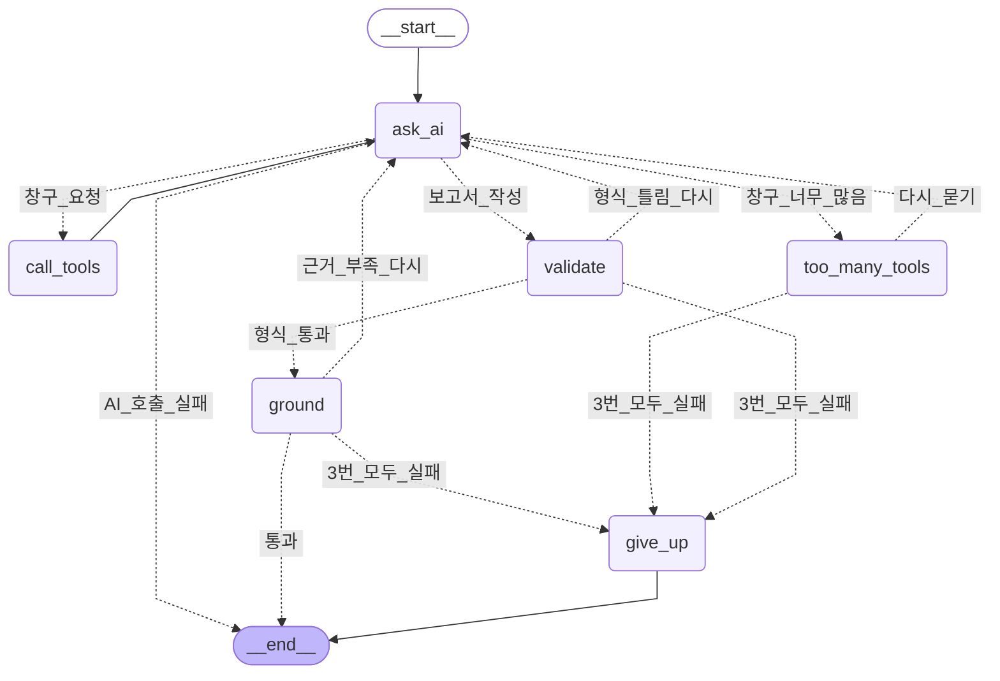

# AI 조사 흐름 (LangGraph)

> 이 문서는 `ai-server/app/agent/graph.py`에서 자동으로 만든다. 그래프를 바꿨으면
> `cd ai-server && uv run python -m scripts.draw_graph`로 다시 만든다 (테스트가 차이를 잡는다).

AI가 사건 하나를 조사하는 순서다.
네모는 할 일(노드), 실선은 늘 가는 길, 점선은 상황에 따라 고르는 길이다.

- `ask_ai` — AI에게 묻는다. AI는 증거 조회 창구를 더 부르거나, 보고서를 쓴다
- `call_tools` — AI가 고른 창구를 Spring에 부르고 결과를 대화에 붙인다 (한 시도 최대 8번)
- AI가 `finish_evidence`(증거 수집 끝)를 부르면 Spring에 묻지 않고,
  다음 질문부터 창구 없이 보고서 모양을 고정한다
- `too_many_tools` — 창구를 너무 많이 부르면 한 번 알리고, 그래도 부르면 형식이 틀린 답으로 센다
- `validate` — 보고서 형식을 검사한다. 틀리면 고쳐 달라고 다시 묻는다
- `ground` — 근거를 검사한다: 출처 · 금액 · 배수 · 건수 · 결제 번호가 받은 증거에 있는지
  통과하면 끝, 아니면 틀린 곳을 짚어 다시 묻는다 (창구 없이 조사했으면 건너뜀)
- 형식 · 근거 다시 묻기는 합쳐서 최대 3번. 다시 물을 때도 창구 없이 보고서 모양을 고정한다
- `give_up` — 3번 모두 검사를 통과하지 못하면 실패로 끝낸다 (직원이 다시 조사 · 직접 판정)
- AI 호출 자체가 실패하면 `ask_ai`에서 바로 끝난다
- Spring이 "현재 시도 아님"이라고 하면 그래프 밖에서 조사를 멈춘다

