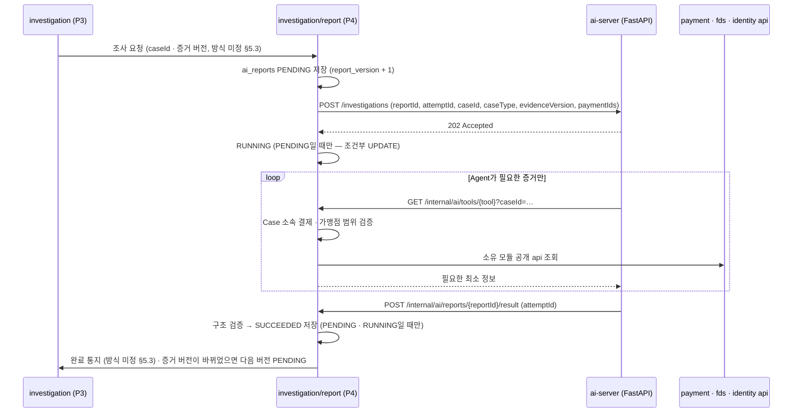

# 0009. AI 조사 호출 구조 (Spring ↔ FastAPI)

- **상태:** 제안 — 팀 합의 필요
- **날짜:** 2026-10-21 (같은 날 개정: fds 정본 ERD Baseline v1의 `ai_reports` 8개 컬럼에 맞춤) · 2026-10-23 개정: 화면 보고서 형식 · Tool 6종 반영 (#112) · 2026-10-26 개정: 조사 요청에 사건 종류 · AI가 쓰는 칸 3유형 (#60) · 결과 수신 · 완료 통지(임시) (#64) · 시간 초과 · 재시작 · 새 정보 대체 (#68) · 증거 조회 Tool 7종 (#70) · AI의 Tool 호출 (#72)
- **관련:** Notion fds 정본 — 02 기획 2.5 · 2.6 · 2.7, 03 설계 3.5 · 3.6 · 3.7 · 3.9⑤ · 3.11, 공통 페이지 §5.3 · §5.4, [ADR-0012](0012-payment-settlement-dependency.md) (ADR-0001 대체), 화면 타입 `frontend/src/types/case.ts`
- **영향 받는 담당:** P4 현규, P3 수민(조사 요청 · 판정 검증), P1 주환(인증 설정 · 보안 이벤트 조회), P2 · P5(Tool이 읽는 공개 api 제공), CakeShop(주문 정보), 화면 담당(보고서 응답 형식)

## 배경

설계 3.6 · 3.7은 다음 구조를 정했다.

- P4 Spring이 FastAPI에 조사를 **비동기**로 요청한다 (`202 Accepted`)
- FastAPI의 AI Agent가 **Spring Tool API**를 호출해 증거를 읽는다 (Tool 6종)
- 결과는 콜백 또는 작업 결과 조회로 받고, Spring이 검증 · 저장한다
- FastAPI는 DB에 직접 접근하지 않고, 금융 상태를 바꾸지 못한다

설계 3.9⑤는 `ai_reports`를 8개 컬럼(`report_id` · `case_id` · `report_version` · `evidence_version` · `status` · `report_body` · `created_at` · `completed_at`)으로 확정했다. 작업 ID · 시도 횟수 · 실패 사유 컬럼은 없고, "시도 횟수 저장 방식은 P4 내부 설계에서 결정"으로 남겼다. 공통 페이지 §5.3(P3 ↔ P4) · §5.4(AI Tool)는 개발 전 결정 항목이 비어 있다.

이 ADR은 (1) FastAPI ↔ Spring 호출의 위치 · 인증, (2) 8개 컬럼 안에서 상태 · 재시도 · 실패를 다루는 방법을 정한다. §5.3 · §5.4는 합의 전이라 미정으로 남긴다.

## 결정 1 — 호출 구조

**Tool API와 결과 수신 엔드포인트를 모두 `investigation/report`에 두고, 내부 전용 경로로 분리한다. 작업 ID는 `report_id`를 그대로 쓴다.**



| 항목 | 정한 것 |
| --- | --- |
| Tool API 위치 | `investigation/report/controller`. Case 권한 검증을 한 곳에서 하고, 아래 모듈 api만 호출하므로 순환이 없다 |
| 경로 | Spring `/internal/ai/**` — 화면용 `/api/**`와 분리. FastAPI `POST /investigations` · `GET /investigations/{reportId}` |
| 작업 ID | `report_id`. 별도 job ID 컬럼을 만들지 않는다 (3.9⑤ 8개 컬럼 유지) |
| 인증 | 서비스 간 키(헤더). 직원 로그인과 별개. 키는 환경 변수, 저장소에 올리지 않는다 |
| 권한 | Tool은 GET만. 결제 · 판정 · Case 상태를 바꾸는 Tool은 만들지 않는다 |
| 결과 수신 | FastAPI 콜백이 기본. 콜백이 정해진 시간 안에 오지 않으면 Spring이 `GET /investigations/{reportId}`로 조회해 복구. 요청 · 콜백 · 조회에는 시도 토큰 `attemptId`를 함께 싣는다 (결정 2). 이전 시도 취소 API는 두지 않는다 |
| 주문 정보 Tool | `get_order_context`는 Spring이 CakeShop을 HTTP로 조회해 전달 (CakeShop 제공 범위는 §5.7 미결) |

### Tool 7종 (Notion 설계 3.6, #70 구현)

| Tool | 입력 (`args`) | 하는 일 | 데이터 주인 | 지금 |
| --- | --- | --- | --- | --- |
| `get_case_payments` | — | Case 소속 결제 목록 (금액 · 상태 · 요청 시각) | P3 + P5 | 있음 |
| `get_fds_evidence` | `paymentIds` (없으면 Case 결제 전부) | 결제별 FDS 점수 · 적중 규칙 | P2 | 있음 |
| `get_payment_history` | — | 고객 과거 결제 패턴 | P5 | 준비 전 (2-22) |
| `get_payment_authentication` | — | 카드 인증 · 승인 정보 | P5 | 준비 전 (2-29) |
| `get_security_events` | — | 로그인 · 기기 · 계정 이벤트 (직원 사건에도) | P1 | 준비 전 (2-3) |
| `get_order_context` | — | 주문 · 배송 · 구매자 연동 정보 | P5 (CakeShop) | 준비 전 (2-22) |
| `find_similar_cases` | — | 비슷한 과거 사건과 판정 결과 (근거로만, 자동 판정 금지) | P3 | 준비 전 (2-9) |

- **주소:** `POST /internal/ai/tools/{toolName}`, 본문 `{ reportId, attemptId, args }`, 서비스 키(`X-Service-Key`)로 지킨다 (결과 수신과 같은 키)
- **응답:** `{ tool, ready, note, data[] }`. 원천 데이터가 아직 없으면 `ready: false`, `note: "데이터 준비 전"`, `data: []` — AI는 모르는 것으로 적는다. 데이터가 생기면 응답만 채운다 (ai-server는 그대로)
- **범위:** 조사 중(`PENDING` · `RUNNING`)인 보고서의 **현재 시도**만 부를 수 있다. 끝났거나 대체된 보고서 · 옛 시도는 `409 RPT_003`, 없는 창구는 `404 RPT_002`, 다른 Case 결제 ID는 `400 RPT_004`
- **기록:** 부를 때마다 `ai_report_steps`에 한 줄(창구 · 성공 여부 · 200자 이내 요약 · 시작 시각 · 걸린 시간)을 남긴다. 원본 증거 · 질문 전문은 남기지 않는다. 조사 과정 전체를 이 표에 모으는 방식은 아래 "조사 단계 실시간 기록"(#78)
- **"`get_fds_evidence` 먼저":** Spring이 강제하지 않고 AI 지시문과 가짜 AI 순서로 지킨다 (강제하면 진짜 AI가 순서를 어길 때마다 조사가 실패한다, #70)

입력에 `caseId`가 있다고 다른 모듈 데이터를 마음대로 읽는 것은 아니다. 각 Tool 구현이 Case 소속 결제 · 가맹점 범위를 검증하고, 소유 모듈의 공개 api로 필요한 정보만 모은다 (설계 3.6 주의).

## 결정 2 — `ai_reports` 8개 컬럼으로 상태 · 재시도 · 실패 다루기

| 상태 | 언제 | 채우는 컬럼 |
| --- | --- | --- |
| `PENDING` | P4가 조사 요청을 받아 행 생성 | `report_version` = 해당 Case 최대값 + 1, `evidence_version` = 요청 시점 Case 증거 버전, `created_at` |
| `RUNNING` | FastAPI가 `202`로 접수. **`PENDING`일 때만** 바꾼다 | — |
| `SUCCEEDED` | 결과 콜백이 구조 검증 통과. **`PENDING` · `RUNNING`일 때만** 바꾼다 | `report_body`(보고서 JSON), `completed_at` |
| `FAILED` | 총 3회 시도 모두 실패 | `report_body`에 `error` 객체(실패 코드 · 사유 · 시도 횟수 · 마지막 시도 시각), `completed_at` = 실패 확정 시각 |
| `SUPERSEDED` | 조사 중 새 증거 버전 요청이 옴 — 새 버전이 이어받음 (실패 아님, #68). **`PENDING` · `RUNNING`일 때만** | `completed_at` (본문은 비움) |

- **상태 변경은 모두 조건부 UPDATE로 한다.** `WHERE report_id = ? AND status IN (…)`처럼 바꿔도 되는 이전 상태를 조건에 넣고, 변경 건수가 0이면 "이미 처리됨"으로 본다. 끝난 상태(`SUCCEEDED` · `FAILED` · `SUPERSEDED`)는 어떤 경로로도 덮어쓰지 않는다
  - 예) 202 응답 직후 FastAPI가 바로 끝나 성공 콜백이 먼저 `SUCCEEDED`를 저장하면, 뒤이은 `RUNNING` UPDATE는 조건(`status = 'PENDING'`)이 맞지 않아 0건 변경으로 끝난다. 그래서 콜백은 `PENDING`에서도 받는다
- **시도마다 새 토큰 `attemptId`(UUID)를 붙인다.** Spring은 보고서별 "현재 시도 토큰" 하나만 기억하고, 콜백 · 조회 결과의 토큰이 **현재 토큰과 같을 때만** 반영한다
  - 다른 토큰의 콜백은 성공 · 실패 모두 무시한다. 이전 시도는 이미 타임아웃으로 실패 1회로 셌다 (같은 실패를 두 번 세지 않음)
  - 서버가 재시작되면 새 시도는 새 토큰을 받는다. 재시작 전 시도의 늦은 콜백도 같은 규칙으로 무시된다 (번호 1 · 2 · 3처럼 다시 겹치지 않음)
  - 행이 끝난 상태면 토큰이 같아도 무시한다 (조건부 UPDATE). `FAILED` 뒤에 늦게 온 성공도 뒤집지 않는다
  - 이전 시도를 취소하지 않는다. FastAPI가 버려질 작업을 끝까지 돌릴 수 있지만 결과는 반영되지 않는다 (MVP에서 감수)
- **재시도는 같은 행에서 한다.** 같은 증거를 다시 분석하는 것이므로 `report_version`을 올리지 않는다. `UNIQUE(case_id, report_version)`과 충돌하지 않는다
- **한 번의 시도 실패**로 세는 것: FastAPI가 202를 주지 않음(연결 실패 · 5xx · 타임아웃), FastAPI가 실패 결과를 보냄, 결과가 시간 안에 오지 않고 조회로도 완료가 아님, 결과가 구조 검증에 실패함
- **결과 대기 시간 (#68):** 시도를 시작한 지 **2분**(`donworry.report.result-timeout`)이 지나도 결과가 없으면, 15초 주기 검사가 ai-server에 `GET /investigations/{reportId}?attemptId=`로 직접 묻는다. 끝난 결과면 콜백과 같은 길로 반영하고(결과 보내기만 실패한 경우), 아직 조사 중 · 404 · 연결 실패면 시도 1번 실패(`AI_RESULT_TIMEOUT`)로 센다
- **시도 횟수는 실행 중에는 Spring 프로세스 안에서 센다.** 최종 실패 때만 `report_body.error.attempts`에 남긴다. 컬럼을 늘리지 않기 위한 선택이며, 아래 "한계"를 받아들인다
- **실패 사유 위치:** 기획 2.5의 "실패 사유 기록"은 `report_body.error`로 충족한다 (별도 컬럼 없음)
- **`error`는 화면에 보내지 않는다.** 실패 이유는 개발자 조사용이다. 조회 응답은 `FAILED`면 `reportBody: null`로 보내고, 화면은 고정 문구("총 3회 시도")를 보여준다
- **AI 실패는 자동 판정으로 이어지지 않는다.** `FAILED`를 P3에 알리고, 직원이 직접 조사해 `report_id = NULL`로 판정한다 (설계 3.7)

**한계 · 재시작 (#68 개정):** 실행 중 Spring이 재시작되면 메모리의 시도 횟수 · 현재 시도 토큰이 사라진다. 그래서 켜질 때 남아 있는 `PENDING` · `RUNNING` 행을 **실패(`SERVER_RESTARTED`)로 닫고** 직원이 직접 판정한다 (2026-10-26 결정). 재시작 전 시도의 늦은 콜백은 토큰이 없어 무시된다. 나중에 "다시 요청(새로 3회)"으로 바꿀 수 있도록 이 처리는 `ReportRestartRecovery` 한 곳에만 둔다. 횟수를 엄밀히 지켜야 한다고 정하면 `attempt_count` 컬럼 추가를 설계 3.9에 먼저 제안한다.

## 결정 3 — 같은 Case의 중복 실행 방지와 버전

- **새 행을 만들지 않는 경우** (설계 3.5 중복 실행 방지)
  - 같은 Case에 **같은 증거 버전으로** `PENDING` · `RUNNING` 행이 있음 — 이미 조사 중이다 (아래 "이상" 규칙에 포함)
  - 요청한 증거 버전 **이상**을 분석한 행이 이미 있음(상태 무관) — 중복 · 재전달 요청이다. `FAILED`여도 다시 만들지 않는다 (3회 제한 유지). 직원의 수동 재실행은 MVP 범위 밖
- **조사 중 새 증거 버전이 오면 대체한다 (#68 개정).** 낡은 증거로 `PENDING` · `RUNNING`인 행을 `SUPERSEDED`로 닫고(조건부 UPDATE), 현재 시도 토큰을 지운 뒤 바로 다음 `report_version`을 `PENDING`으로 만든다. 대체된 시도의 늦은 결과는 토큰이 없어 무시되고, 행도 끝난 상태라 바뀌지 않는다. P3의 "최신 보고서"는 늘 새 버전이라 판정 규칙은 그대로다 (`ReportGateway` 상태 문자열에 `SUPERSEDED` 추가)
  - 이전에는 진행 중이면 요청을 넘기고 끝난 뒤 비교했다. 그러면 직원이 낡은 증거의 결과를 기다린 뒤 다시 기다려야 했다
- **완료 후 비교는 두 단계로 한다** (대체와 함께 안전장치로 남긴다). ① 종료 상태(`SUCCEEDED` · `FAILED`)를 먼저 커밋하고, ② 별도 트랜잭션에서 현재 Case 증거 버전을 읽어 그 행의 `evidence_version`과 비교한다. 다르면 다음 `report_version`을 `PENDING`으로 만든다
  - 예) 완료 처리 중에 결제가 병합되면: 요청이 ① 전에 왔으면 "진행 중"을 보고 넘어가지만 ②가 그 뒤에 새 증거를 읽어 다음 버전을 만든다. ① 뒤에 왔으면 요청이 직접 만든다. 둘 다 만들려 하면 아래 UNIQUE 합류 규칙으로 하나만 남는다
  - 전제: P3는 증거 버전을 **커밋한 뒤** 조사 요청을 보낸다 (§5.3 합의 항목)
- **동시 요청으로 버전 번호가 겹치면 다시 읽어 합류한다.** 같은 Case에 요청 두 개가 동시에 와서 둘 다 "진행 중 없음 · 최대 버전 1"을 보면 둘 다 v2를 저장하려 한다. 늦은 쪽은 `UNIQUE(case_id, report_version)` 위반을 받는데, 이를 오류로 끝내지 않고 진행 중인 행을 다시 읽어 그 작업에 합류한 것으로 처리한다
  - 늦은 쪽이 더 새 증거 버전을 가져왔어도 빠지지 않는다. 바로 아래 "끝나면 비교" 규칙이 다음 버전을 예약한다
- 늦게 도착한 결과는 자기 행에만 쓴다. 다른 버전 행을 덮어쓰지 않는다. 끝난 행에 오는 결과는 무시한다(멱등, 결정 2 조건부 UPDATE)
- "최신 보고서" = Case 최대 `report_version`이면서 `evidence_version`이 현재 Case 증거 버전과 같은 `SUCCEEDED` 행

## 결정 4 — 화면 계약 (보고서 응답 · ID · 권고 값)

보안 직원 화면(`ReportCard`)이 먼저 만들어졌으므로 응답 형식은 화면 타입 `frontend/src/types/case.ts`(`AiReport` · `ReportBody`)를 따른다. **화면 타입과 이 절은 같이 바뀐다. 한쪽만 고치지 않는다.**

- **ID:** DB는 `BIGINT`를 유지하고, P4 응답 JSON에서만 문자열로 보낸다 (`5` → `"5"`). 접두어(`CASE-` 등)는 붙이지 않는다. 요청으로 받은 ID는 문자열 → 숫자로 바꾼다. migration · P3 · 화면은 바꾸지 않는다
- **`report_body` 구조:** 기획 2.7 순서와 같다

| 키 | 화면 섹션 |
| --- | --- |
| `overview` | 1. 사건 개요 |
| `summary` | 2. 핵심 요약 |
| `paymentAnalyses` | 3. 결제별 분석 (위험 근거 · 정상 근거 · 미확인 · 권고) |
| `timeline` | 4. 사건 타임라인 |
| `overallAnalysis` | 5. 종합 분석 |
| `additionalChecks` | 6. 추가 확인 사항 |
| `recommendation` | 7. AI 권고 (요약 · 한계) |
| `evidence` | 8. 증거 추적 (Tool · 출처 · 증거 ID · 조회 시각 · 데이터 버전) |

- **권고 값:** `ACCEPT_REVIEW` / `REJECT_REVIEW` / `NEEDS_CHECK`. 참고용이며 최종 판정은 직원이 한다
- **보고서 속 결제 ID:** Tool로 받은 실제 ID만 쓴다. 저장 전에 Case 소속인지 검증하고, 아니면 구조 검증 실패(시도 실패 1회)로 처리한다
- **AI가 쓰는 칸 (2026-10-26, #60):** 화면 결론 카드(`frontend/src/types/report.ts`)의 [AI] 칸만 ai-server가 쓰고, [Spring] 칸(사건 번호 · 경위 · 결제 이름/금액 · 증거 · 비슷한 사건 · 조사 과정)은 Spring이 합쳐 `report_body`로 저장한다
  - 사건 종류를 알아야 형식을 고를 수 있으므로 조사 요청에 `caseType`(`PAYMENT_FRAUD` · `STAFF_TAKEOVER` · `STAFF_SPRAY`)을 싣는다
  - 공통 칸: `reportType` · `riskScore`(0~100) · `verdict` · `summary` · `recommendations[{label, kind}]` · `riskPoints[{title, detail, source}]` · `normalPoints` · `unknowns` · `checks`(1개 이상)
  - 결제 사기만: `paymentAdvice[{paymentId, recommendation, reason}]` 1개 이상. 직원 사건 2종에 쓰면 구조 검증 실패
  - 정의: `ai-server/app/schemas/report.py` (형식 검사 기준). 요청한 `caseType`과 답의 `reportType`이 다르면 구조 검증 실패
- **결과 수신 구현 (2026-10-26, #64)**
  - ai-server는 조사가 끝나면 `POST /internal/ai/reports/{reportId}/result`로 결과를 보낸다. 같은 서비스 키(`X-Service-Key`)를 쓴다. 보내기 실패는 기록만 하고, Spring의 조회(`GET /investigations/{reportId}`)로 복구한다 (2-18)
  - Spring은 AI 칸을 다시 검사하고(사건 종류 · 필수 칸 · 위험도 범위 · 결제별 권고의 결제 번호가 Case 소속인지), 화면 결론 카드(`frontend/src/types/report.ts` ConclusionReport, schemaVersion 2)로 합쳐 `report_body`에 저장한다. 모르는 칸(경위 · 증거 · 비슷한 사건)은 빈 목록으로 둔다
  - 접수 실패(결정 2)와 결과 실패(ai-server가 실패를 보냄 · Spring 검사 실패)를 **같은 횟수**로 센다. 첫 시도 포함 총 3번이면 `FAILED`
  - `/internal/ai/**`는 직원 로그인이 아니라 서비스 키로 지킨다. 보안 설정(P1)이 전체 API를 잠글 때도 이 경로는 열어 둔다
  - 조사 요청에 사건에 묶인 결제 번호 `paymentIds`를 싣는다 (직원 사건은 빈 목록). 결제 사기면 AI 질문에 이 번호를 적고, ai-server는 답의 결제별 권고가 이 목록 밖이면 구조 검증 실패로 다시 묻는다. Spring의 소속 검사는 마지막 방어선으로 그대로 둔다
    - 이유: 요청에 사건 번호만 있으면 AI는 결제 번호를 알 수 없어 지어낼 수밖에 없다. 실제로 셋을 띄워 돌리자 가짜 AI의 예시 번호가 3번 모두 소속 검사에 걸려 결제 사기 보고서가 늘 `FAILED`가 됐다
    - 버린 안: Tool(2-19)이 생길 때까지 미루기 — 그때까지 ai-server 방식에서 결제 사기 보고서가 한 번도 성공하지 못한다. 결제 금액 · 이력 같은 자세한 증거는 계획대로 2-19 Tool로 읽고, 이 목록은 "이 사건 결제는 이것뿐"이라는 기준으로 남는다
- **실패 정보:** 결정 2대로 `error`는 응답에서 뺀다

## 미정 — P3 ↔ P4 계약 (공통 페이지 §5.3)

정본 §5.3의 개발 전 결정 항목(조사 요청 방식 · 입력, 완료 · 실패 통지, 병합 중 중복 요청 · 구버전 처리, 판정 시 버전 검증 · 수동 판정 전달)은 **P3 담당과 합의 전이라 이 ADR에서 정하지 않는다.** 정해지면 이 절을 갱신한다.

이 ADR이 전제하는 것은 정본에 이미 있는 내용뿐이다.

- 둘 다 `investigation` 모듈 안이라 Modulith 의존 문제는 없다. 다만 테이블 소유가 달라(설계 3.9) P4는 `security_cases` · `case_payments`를, P3는 `ai_reports`를 직접 바꾸지 않는다
- 조사 요청 입력에는 최소 `caseId` · 증거 버전이 들어간다 (§5.3)
- 결정 3은 P3가 증거 버전을 커밋한 **뒤에** 조사를 요청한다고 전제한다. 요청 방식을 정할 때 이 순서를 함께 합의한다
- P4는 조사 완료 · 실패를 P3가 알 수 있게 해야 한다 (§5.3, 설계 3.7 "P3가 최신 보고서 확인 가능")
- **임시 구현 (2026-10-26, #64):** 보고서가 끝나면 P4가 같은 모듈의 P3 `CaseStatusService.refreshById`를 바로 불러 사건 상태를 갱신한다. P3와 통지 방식을 합의하면 이 호출을 바꾼다

## Tool 조회 실패 처리 (공통 페이지 §5.4, #72에서 정함)

**정본에 있는 원칙 (따른다)**

- 미확인 값을 임의로 채우지 않는다, 증거 없는 사실을 단정하지 않는다 (기획 2.7 작성 강제 규칙)
- 확인되지 않은 것은 "미확인 사항 · 판단의 한계"로 분리해 적는다 (기획 2.6 · 2.7, 04 예시 `limitations`)
- 조회 데이터의 품질과 한계를 고려한다 (업무분석 1.2 F)
- 부정거래 확률을 만들어내지 않는다 (기획 2.6)

**정한 것 (#70 · #72, 2026-10-27)**

- **응답 형식:** 데이터가 없으면 `ready: false` + `note`("데이터 준비 전" · "조회 실패") + 빈 `data` (#70). ai-server는 Spring 오류 · 연결 실패 · 5초 응답 초과를 같은 "조회 실패" 결과로 바꿔 AI에게 준다
- **Tool 하나가 실패해도 보고서는 계속 쓴다.** 시도 실패로 세지 않고, AI가 그 내용을 `unknowns`(모르는 것)에 적는다. 예외로 Spring이 `409 RPT_003`(현재 시도 아님)을 주면 그 시도는 이미 버려진 것이라 ai-server가 조사를 멈추고 결과를 보내지 않는다
- **Tool 호출 흐름:** AI가 보고서 대신 Tool 호출을 답하면 ai-server가 Spring 창구를 부르고 결과를 대화에 붙여 다시 묻는다. 어떤 창구를 언제 부를지는 AI가 정한다(지시문에 "`get_fds_evidence` 먼저"). 가짜 AI는 판단 없이 사건 종류별 고정 순서로 부른다 (결제 사기: `get_fds_evidence` → `get_case_payments` → `get_payment_history` → `find_similar_cases`, 직원 사건: `get_security_events` → `find_similar_cases`)
- **최대 호출 수:** 한 시도에서 8번(`AI_SERVER_MAX_TOOL_CALLS`). 넘으면 "이제 답을 쓰세요"를 한 번 알리고, 그래도 부르면 형식이 틀린 답(LLM 재질문 1회)으로 센다
- 없는 창구 이름은 Spring에 묻지 않고 "없는 창구"로 AI에게 알린다. 창구 호출 기록은 Spring `ai_report_steps`가 정본이라 ai-server 과정(`steps`)에는 AI 판단 · 형식 검사만 남긴다

**미정**

- Tool별 반환 필드 · 필수/선택 데이터 — 준비 전 창구 5개는 각 제공 담당(P1 · P3 · P5 · CakeShop) 원천이 생길 때 합의

보고서 JSON(`report_body`) 구조는 결정 4를 따른다 (기획 2.7 순서와 같다).

## 조사 단계 실시간 기록 (#78, 2-19b)

**조사 과정의 모든 단계를 `ai_report_steps` 한 곳에 쌓는다. 화면은 조사 중에도, 끝난 뒤에도 이 표를 읽는다.**

- **누가 남기나:**
  - Spring — 접수 `REQUEST`("ai-server가 조사를 접수함", 재시도면 "(N번째 시도)"), 창구 `TOOL`, 저장 `SAVE`("결론 카드로 저장")
  - ai-server — AI 판단 · 형식 검사가 하나 끝날 때마다 알린다
- **ai-server → Spring 주소:** `POST /internal/ai/reports/{reportId}/steps`, 서비스 키
  - 본문 `{ attemptId, kind, ok, detail, startedAt, durationMs }`. `kind`는 결과 콜백의 `steps`와 같은 `LLM_ANSWER` · `VALIDATION`
  - Spring 저장 이름: `LLM_ANSWER` → `LLM`(실패면 `LLM_FAILED`), `VALIDATION` 통과 → `VALIDATE`, 실패 → `LLM_FAILED`
  - 응답 `204`. 현재 시도가 아니거나 끝난 보고서면 `409 RPT_003` — ai-server는 조사를 멈춘다 (창구와 같은 규칙)
  - 다른 오류 · 연결 실패는 기록만 빠지고 조사는 계속한다 (화면에 한 줄 덜 보일 뿐)
- **AI 판단 단계 이름:** 창구를 고른 판단은 "AI 판단 — 다음에 볼 증거 고르기", 보고서를 쓴 판단은 "AI 판단 — 보고서 작성 (N차)"
- **화면 조사 상태(`GET /api/investigation/cases/{caseId}/report/run`):** 모든 시도의 기록을 시각 순으로 번호를 다시 매겨 준다. 조사 중이면 맨 끝에 "AI가 조사하는 중…"(`RUNNING`) 한 줄을 붙이고 `currentStepNo`가 그 줄을 가리킨다. 시작 시각은 마지막 기록이 끝난 때
- **보고서 `trace`:** 완료 때 같은 기록으로 만든다. 결과 콜백의 `steps`는 ai-server 단계 기록이 하나도 없을 때(옛 ai-server · 알림이 모두 실패)만 쓴다 — 같은 단계가 두 번 들어가지 않는다
- 버린 안: 결과 콜백의 `steps`만으로 과정을 보여 주기(지금까지) — 끝나야 보여서 조사 중 화면이 비어 있다. 화면이 ai-server를 직접 부르기 — 화면은 Spring만 안다 (결정 1)

## 패키지 구성

`investigation/report/` 아래를 다른 모듈과 같은 계층으로 나눈다. `ArchitectureTests`의 `..controller..` · `..entity..` 규칙이 그대로 적용된다.

```
investigation/report/
├── controller/   # /internal/ai/tools/* · /internal/ai/reports/{reportId}/result
├── service/      # 조사 요청 · 재시도 · 버전 비교 · Tool 조합 조회
├── client/       # FastAPI HTTP 호출
├── repository/   # ai_reports
├── entity/       # AiReport
└── dto/          # Tool 응답 · 결과 콜백 · report_body 구조
```

## 고려한 대안

| 대안 | 버린 이유 |
| --- | --- |
| Spring이 증거를 전부 모아 요청에 담아 보냄 (Tool Calling 없음) | 구현은 단순하지만, 설계 2.6 · 3.6이 채택한 Tool Calling(AI가 필요한 증거를 골라 조회)과 다르다 |
| Tool API를 각 소유 모듈(payment, fds …)에 분산 | FastAPI가 여러 모듈 경로를 알아야 하고, Case 소속 · 가맹점 범위 검증이 여러 곳에 흩어진다 |
| FastAPI가 DB를 직접 읽음 | 설계 3.6이 금지한다 |
| 동기 HTTP 한 번으로 보고서를 받음 | 생성 시간이 길어 타임아웃 위험이 있다. 설계 3.7이 비동기 접수(202)를 정했다 |
| 결과 조회(polling)만 사용 | 완료가 늦게 반영되고 Spring에 주기 작업이 필요하다. 콜백 유실 복구용으로만 쓴다 |
| 별도 job ID · `attempt_count` · `error_message` 컬럼 추가 | 설계 3.9⑤가 8개 컬럼으로 확정했다. `report_id`와 `report_body.error`로 충분하다. 재시작 때 횟수 보존이 필요해지면 그때 3.9 변경을 제안한다 |
| `RUNNING`을 FastAPI 호출 전에 저장 | 콜백과의 순서 경합은 막지만, 호출이 실패해도 "진행 중"이 먼저 기록된다. `RUNNING` = "FastAPI가 접수함"이라는 뜻을 유지하고, 경합은 조건부 UPDATE로 막는다 |
| 시도 번호(1 · 2 · 3)로 콜백 구분 | 서버 재시작 후 번호가 다시 1부터 시작해 재시작 전 콜백과 겹친다. UUID 토큰은 겹치지 않고 컬럼도 필요 없다 |
| 이전 시도 취소 API(`DELETE /investigations/…`) | 현재 토큰만 받는 규칙으로 늦은 콜백이 이미 무시된다. 계약을 하나 더 늘릴 이유가 MVP에서는 작다 |
| 최신 요청 증거 버전을 따로 저장(watermark 컬럼) | 설계 3.9⑤ 8개 컬럼을 바꿔야 한다. 종료 커밋 후 비교 순서로 같은 효과를 낸다 |
| 버전 번호를 정할 때 `security_cases` 행을 잠금(`SELECT … FOR UPDATE`) | 동시 요청을 한 줄로 세울 수 있지만 P3 소유 테이블을 P4가 잠그게 된다. UNIQUE 위반 시 다시 읽어 합류하는 방식으로 충분하다 |
| 조사 중 새 정보가 와도 끝날 때까지 기다렸다 비교 (원래 결정 3) | 직원이 이미 낡은 증거의 결과를 기다린 뒤 새 버전을 또 기다려야 한다. 대체해도 늦은 결과는 토큰 규칙으로 무시되어 안전하다 (#68) |
| 재시작 때 남은 조사를 다시 요청(새로 3회) | 시연 중 재시작에도 보고서가 이어지는 장점이 있다. 우선 실패로 닫기로 했고(#68), 바꿀 때는 `ReportRestartRecovery`만 고친다 |
| 재시도마다 새 `report_version` 행 | 같은 증거를 다시 분석하는 것인데 버전이 늘어 "v1 · v2"의 뜻(증거가 바뀜)이 흐려진다 |

## 영향

- API: Spring `/internal/ai/tools/*`(GET 6종) · `/internal/ai/reports/{reportId}/result`(POST) · `/internal/ai/reports/{reportId}/steps`(POST, #78), FastAPI `POST /investigations` · `GET /investigations/{reportId}`
- DB: `ai_reports`는 설계 3.9⑤ 8개 컬럼 그대로. `UNIQUE(case_id, report_version)`. `case_id`는 `security_cases`에 대한 논리 참조
- 보안: `identity/security/SecurityConfig`에서 `/internal/ai/**`를 서비스 키 인증으로 분리해야 한다 — P1과 협의
- P3: §5.3 조사 요청 · 완료 통지 · 판정 검증 방식 합의 필요 (미정)
- P5: Tool 3종(`get_case_payments` 결제 정보 · `get_payment_history` · `get_payment_authentication`)용 조회 api
- P1: `get_security_events`용 조회 api
- CakeShop: `get_order_context` 제공 범위 (§5.7)
- P1 · P2 · P5: §5.4 Tool 응답 형식 · 실패 처리 합의 필요 (미정)
- 화면: AI 최종 실패 알림, 보고서 최신 버전 여부 표시. 보고서 조회 응답은 결정 4 형식이며 `frontend/src/types/case.ts`와 함께 관리
- 테스트: 다른 Case · 가맹점의 결제를 Tool로 조회하면 거부되는지, 구버전 결과가 최신 보고서를 덮어쓰지 않는지, 다른 `attemptId`의 콜백(재시작 전 시도 포함)이 무시되는지, 완료 처리 중 병합돼도 다음 버전이 생기는지, 같은 증거 버전 재요청이 새 행을 만들지 않는지(`FAILED` 포함), 202 직후 성공 콜백이 `RUNNING`으로 덮이지 않는지, 같은 Case 동시 요청이 오류 없이 하나로 합류하는지, 3회 실패 시 `FAILED` · `report_body.error`가 남는지, 실행 중 병합되면 다음 버전이 예약되는지, 화면 응답에 `error`가 없는지, 보고서 속 결제 ID가 Case 소속이 아니면 거부되는지
- 문서: README Architecture · AGENTS.md §6

## 검증

미검증 — 업무 코드 없음. 결정 2 · 3의 동시성 규칙(조건부 UPDATE, 시도 토큰, 완료 후 비교, UNIQUE 합류)은 문서상 설계이며, 구현 단계에서 위 "영향 — 테스트" 항목으로 검증한다.
