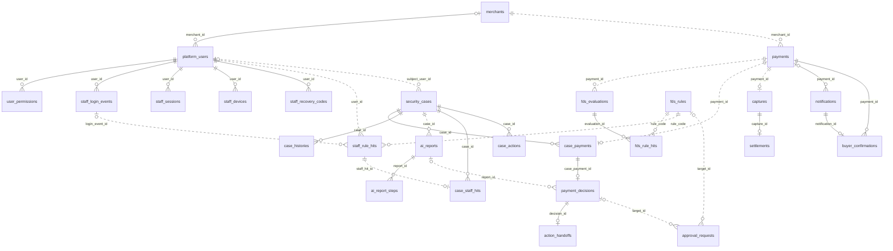

# ERD

> **상태: 목표 ERD 반영 (개인 저장소)** — 팀 1차 MVP 테이블 14개(팀 Issue #56)에 새 기획(최종 기획+설계서)의 테이블 15개 · 컬럼 변경 3건 · 초기 데이터 4건을 migration으로 더했습니다 (개인 Issue #3).
> 테이블은 있지만 이를 쓰는 기능 코드는 아직 없습니다. 각 기능은 PLAN의 2단계 조각에서 만듭니다 (결정됨 · 구현됨(스키마) · 기능 미구현).

## 목차

1. [범위와 정본](#1-범위와-정본)
2. [테이블 소유](#2-테이블-소유)
3. [ERD 그림](#3-erd-그림)
4. [테이블별 컬럼](#4-테이블별-컬럼)
5. [모듈 간 참조 규칙](#5-모듈-간-참조-규칙)
6. [변경 절차](#6-변경-절차)
7. [목표 ERD 변경 내역 (개인 Issue #3)](#7-목표-erd-변경-내역-개인-issue-3)

## 1. 범위와 정본

- 이 저장소는 팀 저장소에서 갈라진 **개인 개발 저장소**입니다. 새 기획의 정본은 Notion **최종 기획+설계서**와 이 문서 7절이고, 팀 1차 MVP 테이블(14개)의 정본은 Notion **팀페이지 / ERD**의 담당별 페이지(P1~P6)입니다
- 실제 DB의 기준(지금 무엇이 있는지)은 `backend/src/main/resources/db/migration/`의 SQL입니다. 이 문서는 소유 · 관계만 요약하고 컬럼은 복사하지 않습니다
- DB 원칙과 INSERT/UPDATE 예시는 Notion fds 정본 **04 DB 설계 및 데이터 매핑**에 있습니다 (구현 가이드)
- 2026-10-22 제공된 P1~P6 담당 ERD를 대조했습니다. [담당별 원문 링크와 차이](../README.md)를 함께 봅니다. 특히 P6의 픽업·정산 완료용 테이블·컬럼은 2차 범위이며 현재 SQL에 없습니다

### 공통 규칙

| 대상 | 규칙 | 예 |
| --- | --- | --- |
| 테이블 이름 | 복수 · snake_case | `payments`, `security_cases` |
| PK | `BIGINT AUTO_INCREMENT` 단일 컬럼 | `payment_id` |
| 다른 테이블 ID | `BIGINT` (가리키는 PK와 같은 타입) | `merchant_id` |
| 상태 · 유형 | `VARCHAR` + JPA `EnumType.STRING` (enum을 이름 문자열로 저장) | `status VARCHAR(30)` |
| 시각 | `DATETIME(6)`, UTC로 저장 (`hibernate.jdbc.time_zone: UTC`) | `created_at` |
| 금액 | `BIGINT`, 원(KRW) 정수 | `amount` |
| 비율 | `DECIMAL(9,6)`, 0~1 | `pg_fee_rate` |
| 구조가 자유로운 값 | `JSON` (MariaDB가 형식을 검사) | `report_body` |
| 중복 방지 키 | MariaDB `UUID` | `idempotency_key` |
| 제약 · 인덱스 이름 | `uk_<테이블>_<컬럼>` · `fk_<테이블>_<대상>` · `idx_<테이블>_<용도>` | `uk_ai_reports_case_version` |

### 1차 생성 때 Notion 양식과 다르게 적용한 것

| 대상 | 양식 | migration | 이유 |
| --- | --- | --- | --- |
| P1 테이블 이름 | `merchant` · `platform_user` · `user_permission` | `merchants` · `platform_users` · `user_permissions` | 테이블 이름은 복수 |
| `user_permissions` PK | `(user_id, permission_code)` 복합 PK | `permission_id` 단일 PK + `UNIQUE(user_id, permission_code)` | PK는 `BIGINT` |
| `fds_rule_hits.applied_score` | 기본값 0 검토 | `DEFAULT 0` | 미적중이면 0 |
| `security_cases.evidence_version` | 초기값 1 검토 | `DEFAULT 1` | 양식 제안값 |

위 표는 최초 생성 당시 차이를 기록합니다. 현재 제공된 P1 ERD 본문에는 `permission_id` 단일 PK가 반영되어 있으나 아래 표에는 이전 복합 PK 표시가 남아 있습니다. 실제 구조는 SQL을 따릅니다.

## 2. 테이블 소유

| 모듈 | 담당 | 테이블 | migration (테이블 순서대로, 테이블당 1개) |
| --- | --- | --- | --- |
| `identity` | P1 주환 | `merchants`, `platform_users`, `user_permissions`, `staff_login_events`, `staff_sessions`, `staff_devices`, `staff_recovery_codes`, `demo_fake_ips` | [20261022_145055](../../backend/src/main/resources/db/migration/V20261022_145055__create_merchants_table.sql) · [20261022_145057](../../backend/src/main/resources/db/migration/V20261022_145057__create_platform_users_table.sql) · [20261022_145059](../../backend/src/main/resources/db/migration/V20261022_145059__create_user_permissions_table.sql) · [20261024_102001](../../backend/src/main/resources/db/migration/V20261024_102001__add_otp_and_lock_fields_to_platform_users.sql) · [20261024_102003](../../backend/src/main/resources/db/migration/V20261024_102003__create_staff_login_events_table.sql) · [20261024_102004](../../backend/src/main/resources/db/migration/V20261024_102004__create_staff_sessions_table.sql) · [20261024_102005](../../backend/src/main/resources/db/migration/V20261024_102005__create_staff_devices_table.sql) · [20261024_102006](../../backend/src/main/resources/db/migration/V20261024_102006__create_staff_recovery_codes_table.sql) · [20261024_102007](../../backend/src/main/resources/db/migration/V20261024_102007__create_demo_fake_ips_table.sql) · [20261024_102020](../../backend/src/main/resources/db/migration/V20261024_102020__seed_demo_fake_ips.sql) · [20261024_102021](../../backend/src/main/resources/db/migration/V20261024_102021__seed_demo_staff_users.sql) |
| `payment` | P5 시은 | `payments`, `notifications`, `buyer_confirmations` | [20261022_145100](../../backend/src/main/resources/db/migration/V20261022_145100__create_payments_table.sql) · [20261024_102000](../../backend/src/main/resources/db/migration/V20261024_102000__add_card_and_buyer_fields_to_payments.sql) · [20261024_102015](../../backend/src/main/resources/db/migration/V20261024_102015__create_notifications_table.sql) · [20261024_102016](../../backend/src/main/resources/db/migration/V20261024_102016__create_buyer_confirmations_table.sql) |
| `fds` | P2 정후 | `fds_evaluations`, `fds_rule_hits`, `fds_rules`, `blocklist_entries`, `staff_rule_hits` | [20261022_145102](../../backend/src/main/resources/db/migration/V20261022_145102__create_fds_evaluations_table.sql) · [20261022_145104](../../backend/src/main/resources/db/migration/V20261022_145104__create_fds_rule_hits_table.sql) · [20261022_174140](../../backend/src/main/resources/db/migration/V20261022_174140__add_fds_evaluation_request_fields.sql) · [20261024_102008](../../backend/src/main/resources/db/migration/V20261024_102008__create_fds_rules_table.sql) · [20261024_102009](../../backend/src/main/resources/db/migration/V20261024_102009__create_blocklist_entries_table.sql) · [20261024_102010](../../backend/src/main/resources/db/migration/V20261024_102010__create_staff_rule_hits_table.sql) · [20261024_102018](../../backend/src/main/resources/db/migration/V20261024_102018__seed_fds_rules.sql) |
| `investigation` | P3 수민 | `security_cases`, `case_payments`, `payment_decisions`, `action_handoffs`, `case_histories`, `case_staff_hits`, `case_actions`, `approval_requests`, `audit_logs` | [20261022_145106](../../backend/src/main/resources/db/migration/V20261022_145106__create_security_cases_table.sql) · [20261022_145108](../../backend/src/main/resources/db/migration/V20261022_145108__create_case_payments_table.sql) · [20261022_145111](../../backend/src/main/resources/db/migration/V20261022_145111__create_payment_decisions_table.sql) · [20261022_145112](../../backend/src/main/resources/db/migration/V20261022_145112__create_action_handoffs_table.sql) · [20261022_145115](../../backend/src/main/resources/db/migration/V20261022_145115__create_case_histories_table.sql) · [20261024_102002](../../backend/src/main/resources/db/migration/V20261024_102002__allow_staff_subject_on_security_cases.sql) · [20261024_102011](../../backend/src/main/resources/db/migration/V20261024_102011__create_case_staff_hits_table.sql) · [20261024_102012](../../backend/src/main/resources/db/migration/V20261024_102012__create_case_actions_table.sql) · [20261024_102013](../../backend/src/main/resources/db/migration/V20261024_102013__create_approval_requests_table.sql) · [20261024_102014](../../backend/src/main/resources/db/migration/V20261024_102014__create_audit_logs_table.sql) |
| `investigation/report` | P4 현규 | `ai_reports`, `ai_report_steps` | [20261022_145116](../../backend/src/main/resources/db/migration/V20261022_145116__create_ai_reports_table.sql) · [20261027_065737](../../backend/src/main/resources/db/migration/V20261027_065737__create_ai_report_steps_table.sql) |
| `settlement` | P6 민정 | `captures`, `settlements`, `loan_products` | [20261022_145118](../../backend/src/main/resources/db/migration/V20261022_145118__create_captures_table.sql) · [20261022_145120](../../backend/src/main/resources/db/migration/V20261022_145120__create_settlements_table.sql) · [20261024_102017](../../backend/src/main/resources/db/migration/V20261024_102017__create_loan_products_table.sql) · [20261024_102019](../../backend/src/main/resources/db/migration/V20261024_102019__seed_loan_products.sql) |
| (공통) | — | `EVENT_PUBLICATION` (Modulith 이벤트 기록) | [create_event_publication_table](../../backend/src/main/resources/db/migration/V20261021_215412__create_event_publication_table.sql) |

## 3. ERD 그림

실선은 물리 FK(DB가 검사), 점선은 논리 참조(ID 값만 저장, FK 없음)입니다. `|o`는 0 또는 1(NULL 허용), `||`는 정확히 1입니다.

다른 테이블과 관계가 없는 것: `blocklist_entries`(값으로 조회), `demo_fake_ips`(시연 IP 판정), `loan_products`(Mock 상품 조회), `audit_logs`(모든 모듈의 기록을 이벤트로 받음).

그림에 없는 논리 참조 (1차 MVP): `security_cases` · `captures` · `settlements`의 `merchant_id`(→ `merchants`), `payment_decisions.staff_id` · `case_histories.actor_id`(→ `platform_users`), `settlements.payment_id`(→ `payments`), `action_handoffs.target_operation_id`(P5 · P6 작업 ID).

## 4. 테이블별 컬럼

컬럼 · 타입 · 제약은 2절 표의 migration 파일을 봅니다. 설명과 업무 제약(예: "재시도 시 `requested_at` 유지")은 Notion 담당 페이지를 봅니다. 로컬 DB에서는 `SHOW CREATE TABLE <테이블>;`로 확인합니다 ([Flyway 05 5절](../flyway/05-guide.md#5-기존-스키마-확인하는-법)).

## 5. 모듈 간 참조 규칙

[AGENTS.md 4절](../../AGENTS.md#4-backend-규칙)의 규칙을 그대로 따릅니다.

| 관계 | 참조 방식 | 예시 |
| --- | --- | --- |
| 같은 소유 담당의 테이블끼리 | 물리 FK(외래 키 제약을 DB에 건다) | `security_cases` ↔ `case_payments` (둘 다 P3) |
| 소유 담당이 다른 테이블 | 논리 참조(ID 값만 저장, FK 없음) | `fds_evaluations.payment_id` (P2 → P5) |
| 같은 `investigation` 모듈 안의 P3 ↔ P4 | 논리 참조 (예외) | `ai_reports` ↔ `security_cases` · `payment_decisions` |
| 담당 모듈마다 대상이 다른 ID | 논리 참조 + 대상 종류 컬럼 | `approval_requests.target_type` + `target_id` |

- 논리 참조 대상의 존재 확인은 DB가 아니라 소유 담당 모듈의 공개 `api/`로 합니다
- 참조되는 금융·조사·보안 기록(결제·평가·Case·판정·인계·보고서·로그인 기록·직원 경보·승인 요청·감사 로그)은 물리 삭제하지 않습니다. 해제 · 만료는 시각 컬럼(`released_at` · `revoked_at` · `ended_at`)으로 남깁니다. 그래서 FK에 `ON DELETE` 옵션을 두지 않습니다 (참조 중이면 삭제 거부)

## 6. 변경 절차

1. 새 기획 범위는 이 문서 7절과 Notion 최종 기획+설계서를 먼저 고칩니다. 7절에 없는 테이블·컬럼은 추가하지 않습니다
2. 소유 담당이 새 Flyway 마이그레이션(`ALTER` 등)을 추가합니다. 병합된 파일은 고치지 않습니다 → [Flyway 작업 가이드 1절](../flyway/05-guide.md#1-테이블-추가-순서)
3. 테이블이 늘거나 관계가 바뀌면 같은 PR에서 이 문서의 2·3절을 갱신합니다

## 7. 목표 ERD 변경 내역 (개인 Issue #3)

새 기획(결제 FDS · 직원 계정 보호 · 자금 관리)에 맞춰 더한 것입니다. 기존 migration 18개는 고치지 않고 새 파일만 더했습니다. 컬럼 정의는 각 migration 파일을 봅니다.

### 기존 테이블 변경

| 테이블 | 변경 | 쓰는 곳 |
| --- | --- | --- |
| `payments` | `buyer_email` · `client_ip` · `device_id` · `card_fingerprint`(카드번호 해시) · `card_last4` · `card_country` · `customer_joined_at` 추가 (모두 NULL 허용), IP · 고객별 시각 인덱스 | 결제 Rule 8개, 구매자 메일 |
| `platform_users` | `otp_secret_encrypted` · `otp_enabled` · `failed_login_count` · `locked_until` 추가 | 2단계 인증, 로그인 실패 잠금 |
| `security_cases` | `merchant_id` · `customer_ref`를 NULL 허용으로, `subject_user_id`(대상 직원) 추가 | 직원 계정 사건 |

### 값만 늘어난 컬럼 (스키마 변경 없음)

| 컬럼 | 새 값 |
| --- | --- |
| `platform_users.role` | `SECURITY_MANAGER` (보안 관리자: 직원 사건 판정 · 2인 승인). `UserRole` enum에 함께 추가 |
| `security_cases.case_type` | `STAFF_TAKEOVER`(직원 계정 탈취 의심) · `STAFF_SPRAY`(직원 계정 분산 대입 공격). 기존 `PAYMENT_FRAUD`는 그대로 |
| `security_cases.status` | `APPROVAL_PENDING`(2인 승인 대기). 조치 진행 중은 기존 `ACTION_PENDING`을 그대로 쓴다 (개인 Issue #10) |
| `ai_reports.report_body` | 결론 카드 구조 (JSON, PLAN 0-5) |

### 새 테이블

| 모듈 | 테이블 | 한 줄 설명 |
| --- | --- | --- |
| P1 `identity` | `staff_login_events` | 직원 로그인 시도 기록 (성공 · 실패, IP · 기기) |
| | `staff_sessions` | 직원 접속 세션 (강제 종료 · 동시 사용 탐지) |
| | `staff_devices` | 직원별 등록 기기 |
| | `staff_recovery_codes` | OTP 복구 코드 (해시) |
| | `demo_fake_ips` | 시연용 가짜 IP와 위치 (demo 프로필 전용) |
| P2 `fds` | `fds_rules` | Rule 카탈로그 15개 (결제 8 · 직원 7), 점수 · 위험도 · 켜기/끄기 |
| | `blocklist_entries` | 차단 목록 (카드 · IP · 이메일 · 기기) |
| | `staff_rule_hits` | 직원 Rule 적중 기록 (직원 경보) |
| P3 `investigation` | `case_staff_hits` | 직원 사건에 묶인 직원 경보 |
| | `case_actions` | 직원 사건 조치 (세션 종료 · 계정 잠금 · OTP 재등록 등) |
| | `approval_requests` | 2인 승인 요청. 요청자 본인 승인은 `CHECK` 제약으로도 막음 |
| | `audit_logs` | 감사 로그 (수정 · 삭제 없음) |
| P4 `investigation/report` | `ai_report_steps` | AI 조사 과정 한 단계 (증거 조회 Tool 호출 등, 짧은 요약만). 끝나면 `report_body.trace`로 요약 복사 (#70) |
| P5 `payment` | `notifications` | 구매자 · 사장님 메일 발송 기록 |
| | `buyer_confirmations` | "본인 결제가 맞나요?" 구매자 응답 (약한 근거) |
| P6 `settlement` | `loan_products` | Mock 은행 대출 상품 |

### 초기 데이터

| migration | 내용 |
| --- | --- |
| `seed_fds_rules` | Rule 15개 (판정 구간: 0~39 ALLOW · 40~69 REVIEW · 70+ DENY, 차단 목록은 즉시 DENY) |
| `seed_loan_products` | 가상 은행 대출 상품 3개 |
| `seed_demo_fake_ips` | 가짜 IP 38개 (사내망 3 · 국내 3 · 익명 2 · 분산 공격 30) |
| `seed_demo_staff_users` | 시연 직원 3명: `jiwon` 박지원(보안 직원) · `yunseo` 최윤서(보안 관리자) · `dohyun` 이도현(보안 직원). 비밀번호 1234, OTP는 demo 프로필 고정 코드 |

### 이번에 만들지 않은 것

- 14일 자금 예측: 저장하지 않고 정산 예정금 · Mock 은행 잔액으로 계산합니다
- 사내망 IP 범위(`10.20.0.x`): 테이블이 아니라 `application.yml` 설정값으로 둡니다 (PLAN 2-4)
